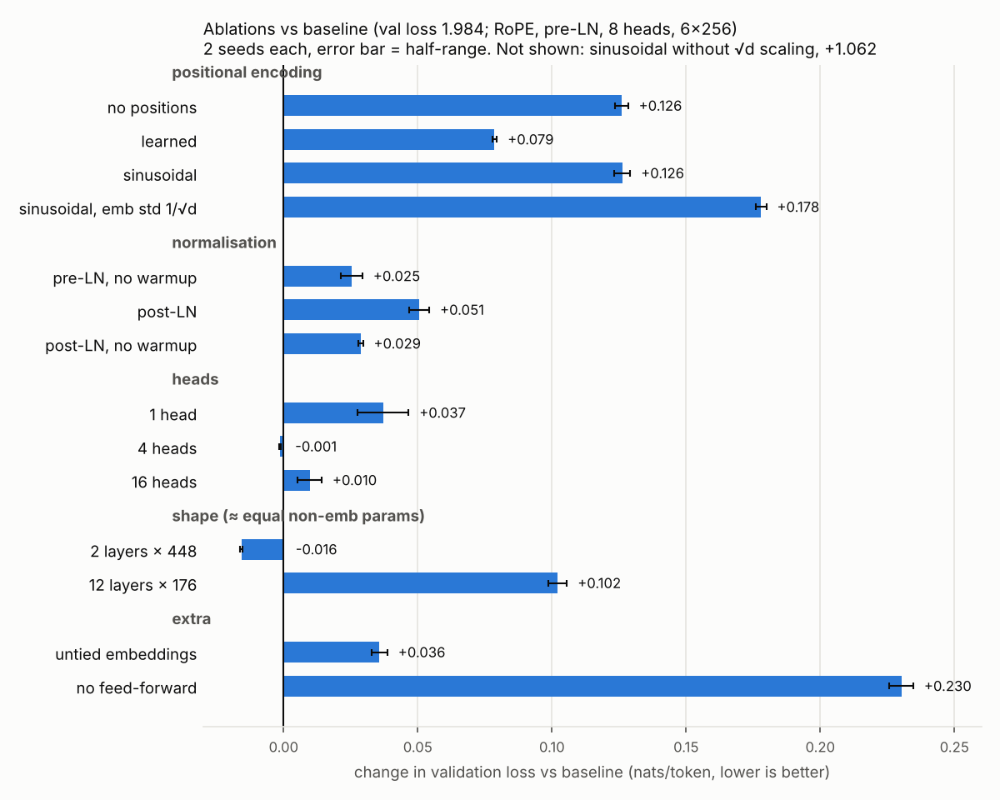

# Transformer from scratch: which design choices matter?

A small GPT-style (decoder-only) transformer written from scratch in PyTorch and trained
on [TinyStories](https://huggingface.co/datasets/roneneldan/TinyStories) using free
Colab GPUs. Controlled ablations then test which parts of the architecture actually matter
at this scale: positional encoding, where LayerNorm goes, LR warmup, number of heads,
depth vs width, weight tying and the feed-forward block.

**Headline:** at ~6M parameters and ~41M training tokens, the feed-forward block, RoPE and
depth-vs-width choices matter most (0.10 to 0.23 nats/token); head count beyond 4,
warmup and LayerNorm placement matter little (0.00 to 0.05). 32 training runs, all on a
free Colab T4.

## What is written by hand

`src/model.py` uses only basic PyTorch layers (`nn.Linear`, `nn.Embedding`, `nn.LayerNorm`).
Written here:

- multi-head causal self-attention (scores, mask, softmax, head split/merge)
- positional encodings: rotary (RoPE), learned absolute, fixed sinusoidal, or none
- pre-LN (GPT-2) and post-LN (original 2017 paper) blocks
- GPT-2 style init, weight tying, sampling with temperature and top-k
- training loop: AdamW, warmup + cosine LR, gradient clipping, fp16 mixed precision

The tokenizer is a 4,096-token byte-level BPE trained with the HuggingFace `tokenizers`
library on the training stories only (not the point of the project, so not hand-written).

## Correctness checks (`pytest`)

- hand-written attention equals `F.scaled_dot_product_attention` (to 1e-5)
- no future leakage: changing token t leaves outputs before t unchanged, for all 8
  position x norm variants
- RoPE: the q·k score depends only on relative distance
- the model overfits a single batch; training loop writes metrics and resumes correctly

## Setup

| | |
|---|---|
| Baseline | 6 layers, d_model 256, 8 heads, FFN 1024, context 256, pre-LN, RoPE, tied embeddings, dropout 0.1 |
| Parameters | 5.79M (4.74M excluding embeddings) |
| Training | 2,500 steps x 64 x 256 = ~41M tokens per run; AdamW (0.9, 0.95), lr 1e-3 -> 1e-4 cosine, 200 warmup steps, wd 0.1, clip 1.0 |
| Data | first 600k TinyStories training stories; metric = loss on the full official validation split |
| Hardware | Colab free T4 |
| Seeds | 2 per configuration; differences smaller than the seed spread are treated as noise |

## Ablations

| group | configurations |
|---|---|
| positional encoding | none, learned, sinusoidal, RoPE (baseline) |
| normalisation | pre-LN vs post-LN, each with and without LR warmup |
| heads (d_model fixed at 256) | 1, 4, 8 (baseline), 16 |
| depth vs width (~equal non-embedding params) | 2 x 448, 6 x 256 (baseline), 12 x 176 |
| extra | untied embeddings, no feed-forward block |
| follow-up checks | sinusoidal without the sqrt(d) embedding scaling; sinusoidal with token-embedding init std 1/sqrt(d) |

## Results

Validation loss (cross-entropy in nats/token) on the full official TinyStories validation
split, ~4.9M tokens never seen in training. Mean of 2 seeds; ± is half the gap between
the two seeds. The baseline's own two seeds differ by 0.011, so **differences under
about 0.01-0.015 are treated as noise.** Full table: [`results.md`](results.md).



| change vs baseline | val loss | Δ | verdict |
|---|---|---|---|
| **baseline** (RoPE, pre-LN, warmup, 8 heads, 6 x 256, tied) | 1.984 | | perplexity 7.3 |
| no feed-forward block (attention only) | 2.215 | +0.230 | largest effect |
| sinusoidal positions | 2.111 | +0.126 | no better than no positions |
| no positional encoding | 2.110 | +0.126 | still trains, via the causal mask |
| 12 layers x 176 (deep, narrow) | 2.087 | +0.102 | worse and 1.7x slower |
| learned positions | 2.063 | +0.079 | RoPE clearly better |
| post-LN (with warmup) | 2.035 | +0.051 | worse |
| 1 attention head | 2.022 | +0.037 | worse |
| untied embeddings (+1M params) | 2.020 | +0.036 | tying helps |
| post-LN, no warmup | 2.013 | +0.029 | did not diverge |
| pre-LN, no warmup | 2.010 | +0.025 | warmup helps a little |
| 16 heads | 1.994 | +0.010 | within noise, 1.5x slower |
| 4 heads | 1.983 | -0.001 | tie |
| 2 layers x 448 (shallow, wide) | 1.969 | -0.016 | slightly better and 1.8x faster |

What I take from it, with the caveats that matter:

- **The feed-forward block matters most.** Removing it costs 0.23. This also removes
  ~3.1M of 5.8M parameters, so it measures "attention-only at the same width", not the
  MLP at equal size.
- **RoPE beats every absolute scheme by 0.08 or more.** With no positional encoding at
  all the model still learns reasonably (+0.13): a causal model can infer position from
  the mask (consistent with Haviv et al., 2022).
- **Sinusoidal positions gave no benefit over no positions, and are fragile.** I first
  guessed the sin/cos table was too loud relative to the token embeddings, and ran two
  follow-ups. Dropping the paper's sqrt(d) embedding scaling made it far worse (3.046,
  +1.06; the table swamps the 0.02-std embeddings). Making the embeddings larger
  (init std 1/sqrt(d)) also made it worse (2.162), so **my hypothesis was wrong**. I
  report the plain result: in this setup sinusoidal is no better than nothing, and very
  sensitive to embedding scale, while RoPE needs no such tuning. (Caveat: with tied
  weights the embedding std also changes the output layer's init.)
- **Shape: at a fixed token budget, shallow-wide won and deep-narrow lost.** 2 x 448 beat
  the baseline by 0.016 (about 1.5x the baseline seed gap, so small) while running 1.8x
  faster. 12 x 176 lost 0.10. Likely reasons: a short training run favours shallow models,
  and all variants share one learning rate tuned for nothing in particular. Deeper models
  often win with more data, so this should not be read as "depth is bad".
- **Post-LN did not blow up**, even without warmup; it was 0.03-0.05 worse than pre-LN.
  The well-known post-LN instability (Xiong et al., 2020) is reported for deeper models
  and larger learning rates; at 6 layers with gradient clipping I did not reproduce it.
  Post-LN was slightly *better* without warmup than with it (0.022, about 2x the noise
  level) - small, and I would not build a claim on it.
- **Heads: one head is worse (+0.037); 4, 8 and 16 are tied.** More heads only cost time
  here (16 heads: 12 min vs 8 min per run, since attention is computed per head).
- **Weight tying helps** (+0.036 without it) despite untying adding 1M parameters.

### Sample (baseline, seed 0, prompt "Once upon a time", temperature 0.8, top-k 50)

> Once upon a time there was a little girl called Molly. She was three years old, but she
> didn't have any money. One day, Molly was playing with her friends at the park. She was
> having so much fun, she forgot about her mom. Her mom said "Let's go to the park!"
> Molly and her mom went to the park. Molly was so excited. She jumped over the swings and
> started to swing, swing and slides and slide. Molly had so much fun on her swing! [...]

Grammatical and on-topic, with typical small-model logic slips (other samples: "walked
down the tree", "the fruit was eating").

## Run it

```bash
pip install -r requirements.txt
pytest
python run.py list                                    # configs and parameter counts
python run.py prepare --data data                     # download + tokenize (~10-15 min)
python run.py train --data data --out runs --group baseline pos --seeds 0 1
python analyze.py --out runs                          # results.md + plots/
python sample.py --run runs/baseline_s0 --data data
```

Or open `colab.ipynb` in Colab with a T4 runtime; it keeps data and results on Google Drive.

## Limitations

- One small dataset and one model scale (~6M params, ~41M tokens). Findings may not
  transfer to large models.
- Two seeds per configuration, so only fairly large differences can be called real
  (the baseline's seeds differ by 0.011).
- Validation loss only; no downstream task or human rating of the stories.
- Same hyperparameters (learning rate etc.) for every ablation; some variants might do
  better with their own tuning.
